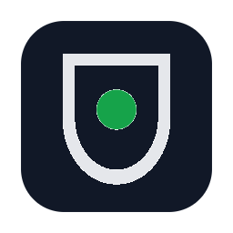
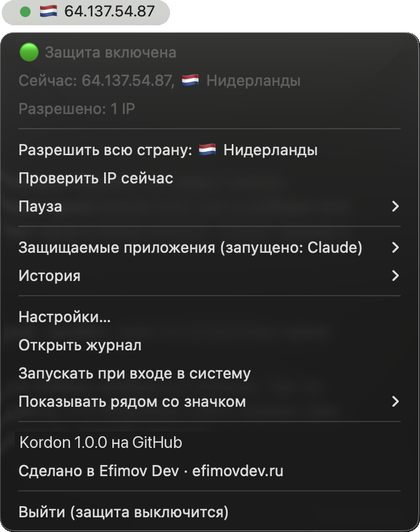

<p align="center"></p>

<h1 align="center">Kordon</h1>

<p align="center">
  <b>A kill switch for apps.</b> Your VPN drops, your IP changes or the internet goes away - Kordon freezes the apps you chose within a fraction of a second. The right IP is back - they carry on as if nothing happened.
</p>

<p align="center">
  <a href="https://github.com/ef1m03/kordon/releases/latest"></a>
  <a href="https://github.com/ef1m03/kordon/actions/workflows/ci.yml"></a>
  
  <a href="LICENSE"></a>
  · <a href="README.md">Русский</a>
</p>

<p align="center"></p>

## Why Kordon

| | VPN client kill switch | Firewall rules | **Kordon** |
|---|:---:|:---:|:---:|
| Only touches the apps you chose | ❌ cuts everything | ✅ | ✅ |
| A 2-second VPN blip doesn't lose your work | ❌ | ❌ drops connections | ✅ freezes |
| Allow a whole country, not one address | ❌ | ❌ | ✅ |
| IP and country visible at a glance | ❌ | ❌ | ✅ |
| Works with proxy-mode VPN clients | depends | ❌ | ✅ |
| Catches IPv6 leaks when the VPN tunnels only IPv4 | not always | ❌ | ✅ |
| No admin rights needed | not always | ❌ | ✅ |
| Same tool on macOS, Windows and Linux | ❌ | ❌ | ✅ |

## What it does

- **Freezes instead of killing.** The network changes, the protected apps are paused (`SIGSTOP` / `NtSuspendProcess`). Same IP - you won't notice. An allowed IP is back within 20 s - the app continues where it was.
- **Closes them if the IP doesn't come back**: politely first so they can save, then by force. While the IP isn't allowed they can't be started again.
- **Allow IPs, subnets or whole countries** - VPNs rotate addresses within a country all the time.
- **Your IP and country always in sight**: flag and IP in the macOS menu bar, a country-code badge in the Windows tray, coloured by state.
- **Presets**: Claude, ChatGPT, Codex, Cursor, Windsurf, GitHub Copilot, Gemini CLI, Perplexity, Telegram, Discord, Slack, Zoom, plus any app of your own.
- **IPv6 leaks**: many VPNs tunnel only IPv4; Kordon checks both addresses.
- **Whole process trees**: everything the app started (MCP servers, `curl`, `git` under Claude Code) is frozen too.
- **Two independent services must agree** on the IP; any disagreement counts as a possible leak.
- **Instant reaction** to OS network events, and a supervisor that restarts Kordon if it ever crashes.
- **Proxy-mode VPN clients** (v2rayN, Hiddify, Clash) are handled: the IP is checked through the system proxy, the way your apps see it.
- Pause, event history, a screen-sharing mode that hides the IP, hot-reloaded `config.yaml`.
- No admin rights, no telemetry, open source.

## Install

macOS / Linux:

```bash
curl -fsSL https://raw.githubusercontent.com/ef1m03/kordon/main/scripts/install.sh | sh
```

Windows (PowerShell):

```powershell
irm https://raw.githubusercontent.com/ef1m03/kordon/main/scripts/install.ps1 | iex
```

Or grab the files from the [latest release](https://github.com/ef1m03/kordon/releases/latest). The builds aren't notarized/signed (that's paid), so the first manual launch needs *right click → Open* on macOS (*System Settings → Privacy & Security → Open Anyway* on macOS 15+) or *More info → Run anyway* on Windows. The install scripts avoid that.

On first start Kordon **allows the current IP**, so install it with your VPN on. Claude is protected by default; pick other apps in the *Protected apps* menu.

## Settings

`config.yaml` lives in `~/Library/Application Support/Kordon/` (macOS), `%APPDATA%\Kordon\` (Windows) or `~/.config/kordon/` (Linux). It is commented and reloaded on save.

```yaml
apps: ["claude", "cursor"]
custom_apps:
  - name: "My client"
    match: ["/MyClient.app/", "myclient.exe", "args:my-tool/cli.js"]
allow:
  ips: ["64.137.54.87", "185.12.40.0/24"]
  countries: ["NL", "DE"]
grace: 20s
close_timeout: 5s
check_interval: 5s
min_agree: 2
check_ipv6: true
menubar: ip   # ip, country or icon
```

CLI: `kordon status`, `kordon allow [IP|subnet|CC]`, `kordon config`, `kordon autostart on|off`, `kordon headless`.

## What goes over the network

Only two kinds of requests: the public IP (`api.ipify.org`, `ipv4.icanhazip.com`, `v4.ident.me`, `checkip.amazonaws.com`, `ipinfo.io/ip`; IPv6: `api6.ipify.org`, `ipv6.icanhazip.com`, `v6.ident.me`; all configurable) and its country (`ipinfo.io`, falling back to `ipapi.co` and `api.country.is`, cached). No analytics, no update checks.

## How safe is it

Covered: IPv6 leaks, child processes, a single lying IP service, missed network changes, Kordon crashing, tampered downloads (installers check SHA-256; every build carries a GitHub attestation: `gh attestation verify <file> --repo ef1m03/kordon`).

Not covered, honestly: Kordon works at the app level, not the network level - there are milliseconds between a network change and the freeze, so use your VPN's own kill switch too if you need "not a single packet". Admin processes and services aren't touched. Malware on the same machine can just stop Kordon. PAC proxy scripts aren't supported. On Windows, npm-installed Claude Code started from a terminal runs as `node.exe` - use the native installer.

## Build

```bash
go test ./...
./scripts/build-mac.sh        # dist/Kordon.app
./scripts/build-windows.sh    # dist/kordon-windows-*.exe
CGO_ENABLED=0 go build ./cmd/kordon
```

---

<p align="center">By <a href="https://github.com/ef1m03">ef1m03</a>. Made at <a href="https://efimovdev.ru"><b>Efimov Dev</b></a>. MIT license.</p>
