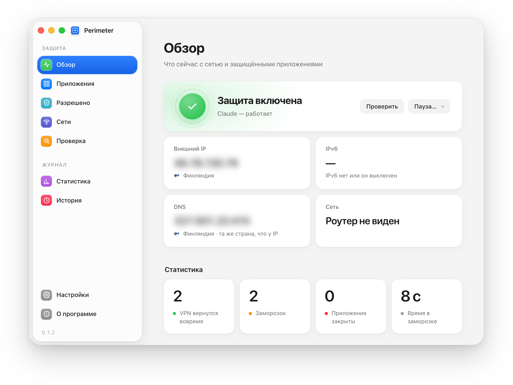
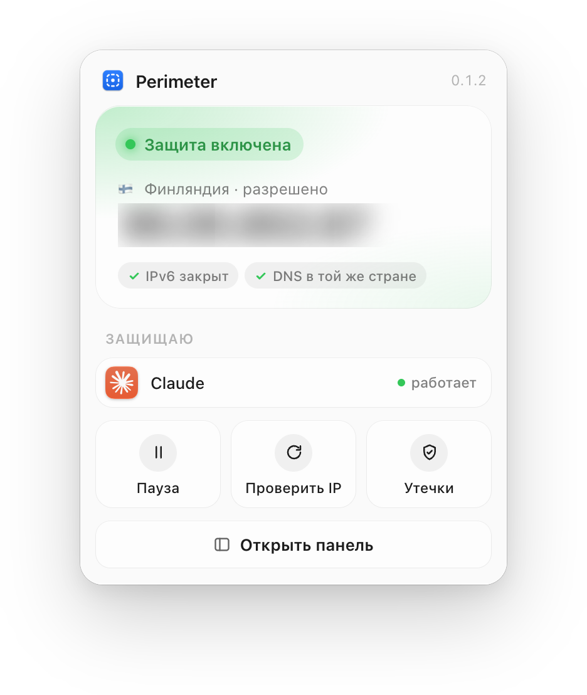
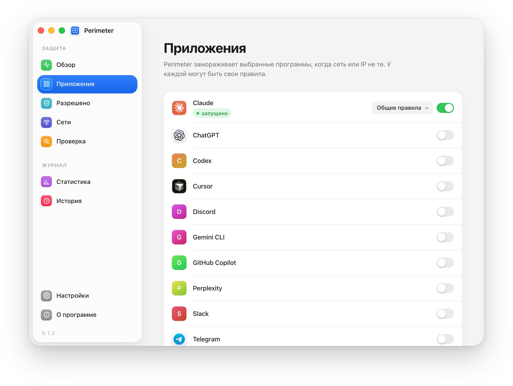
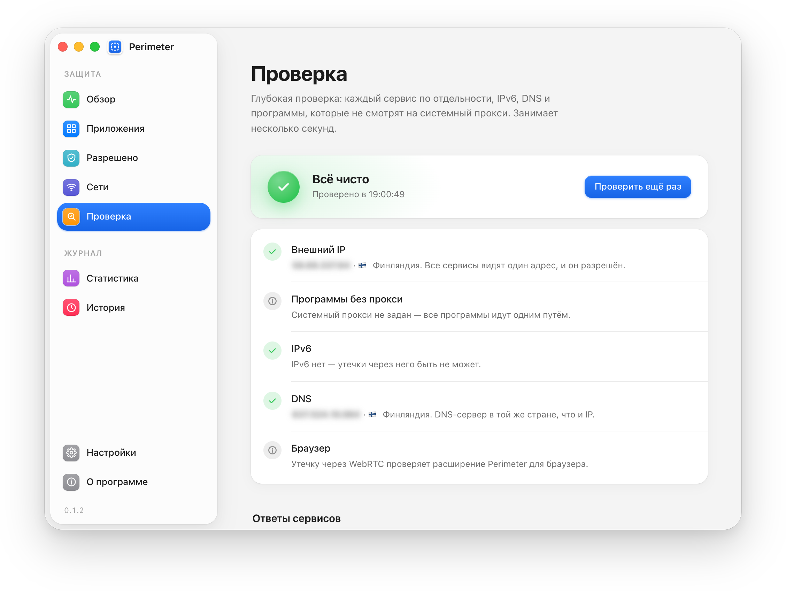
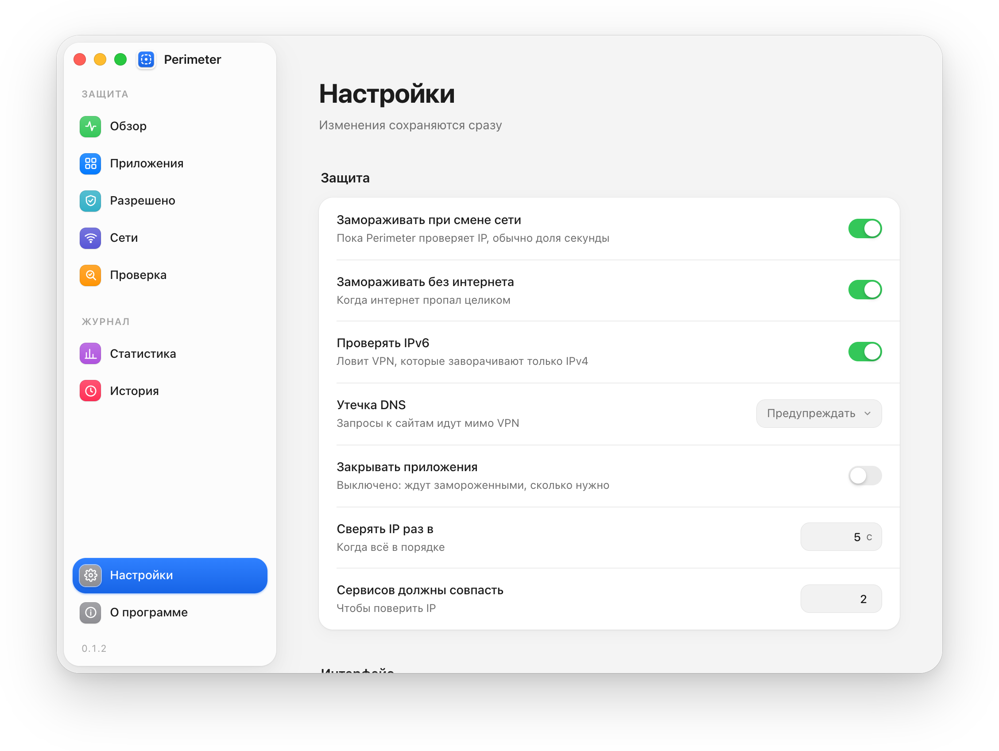

<p align="center"></p>

<h1 align="center">Perimeter</h1>

<p align="center">Kill switch для отдельных программ.<br>
Если VPN отвалился, Claude, ChatGPT, Cursor и другие выбранные программы встают на паузу. Остальной интернет продолжает работать.</p>

<p align="center">
  <a href="https://github.com/LuckyKort/perimeter/releases/latest"><b>Скачать</b></a> ·
  <a href="#установка">Установка</a> ·
  <a href="#как-это-работает">Как это работает</a> ·
  <a href="#что-perimeter-отправляет-в-сеть">Что уходит в сеть</a>
</p>

<p align="center">
  <picture>
    <source media="(prefers-color-scheme: dark)" srcset="docs/img/overview-dark.png">
    
  </picture>
</p>

Kill switch в VPN-клиенте отключает интернет целиком. Если туннель на секунду пропал, обрывается созвон, падает загрузка, замолкает музыка. При этом защитить обычно нужно всего пару сервисов, которые могут заблокировать аккаунт за вход с «не того» IP.

Perimeter следит за внешним IP и, если адрес поменялся, ставит на паузу только те программы, которые вы выбрали. Когда VPN возвращается, они продолжают работать с того же места.

## Что умеет

<table>
<tr>
<td width="55%">

Программы не закрываются, а приостанавливаются вместе со всеми дочерними процессами. Если VPN моргнул на пару секунд, вы этого почти не заметите, а недописанное сообщение в чате никуда не денется. Можно включить и закрытие: тогда программа закроется, если разрешённый IP не вернулся за заданное время.

В списке уже есть Claude, ChatGPT, Cursor, Codex, Gemini CLI, Copilot, Perplexity, Slack и Telegram. Можно добавить любую другую программу и задать для неё отдельные правила.

Разрешать можно отдельные IP, подсети или целые страны.

</td>
<td>
  <picture>
    <source media="(prefers-color-scheme: dark)" srcset="docs/img/popover-dark.png">
    
  </picture>
</td>
</tr>
</table>

IP сверяется минимум по двум независимым сервисам, отдельно проверяются IPv6 и DNS. Это ловит VPN, которые пропускают через туннель только IPv4. Смену сети Perimeter замечает по системным событиям и проверяет адрес сразу, не дожидаясь таймера.

Домашнюю или рабочую сеть можно отметить как доверенную, и там программы будут работать без VPN. Сеть узнаётся по роутеру.

Для браузера есть расширение. Оно ставит на паузу только вкладки с ИИ и не даёт сайтам узнать настоящий адрес через WebRTC.

Аккаунт не нужен, своих серверов у проекта нет, статистику использования Perimeter не собирает. Права администратора тоже не нужны.

<table>
<tr>
<td width="50%">
  <picture>
    <source media="(prefers-color-scheme: dark)" srcset="docs/img/apps-dark.png">
    
  </picture>
  <p align="center"><sub>Какие программы защищать</sub></p>
</td>
<td width="50%">
  <picture>
    <source media="(prefers-color-scheme: dark)" srcset="docs/img/leaks-dark.png">
    
  </picture>
  <p align="center"><sub>Проверка утечек</sub></p>
</td>
</tr>
</table>

## Как это работает

Раз в несколько секунд и сразу после смены сети Perimeter узнаёт свой внешний IP у нескольких сервисов.

- Адрес разрешён: программы работают, значок зелёный.
- Адрес не тот или пропал интернет: выбранные программы замирают, значок оранжевый.
- Разрешённый адрес вернулся: программы продолжают работу.
- Если включено закрытие, а адрес так и не вернулся, программы закрываются, значок становится красным.

> [!TIP]
> При первом запуске Perimeter разрешает текущий IP, поэтому запускайте его с включённым VPN.

## Установка

Работает на macOS 11 и новее, Windows 10/11 и Linux. Готовые сборки лежат в [релизах](https://github.com/LuckyKort/perimeter/releases/latest), но проще поставить одной командой.

macOS и Linux:

```bash
curl -fsSL https://raw.githubusercontent.com/LuckyKort/perimeter/main/scripts/install.sh | sh
```

Windows (PowerShell):

```powershell
irm https://raw.githubusercontent.com/LuckyKort/perimeter/main/scripts/install.ps1 | iex
```

Новые версии Perimeter находит сам. Когда выходит обновление, он показывает список изменений и ставит его по кнопке, предварительно сверив контрольную сумму.

<p align="center">
  <picture>
    <source media="(prefers-color-scheme: dark)" srcset="docs/img/settings-dark.png">
    
  </picture>
</p>

## Что Perimeter отправляет в сеть

Только запросы, без которых не узнать свой IP и страну:

- IPv4: `api.ipify.org`, `ipv4.icanhazip.com`, `v4.ident.me`, `checkip.amazonaws.com`, `ipinfo.io` (список можно поменять в настройках);
- IPv6: `api6.ipify.org`, `ipv6.icanhazip.com`, `v6.ident.me`;
- страна: `ipinfo.io`, `ipapi.co`, `api.country.is`;
- проверка обновлений на GitHub.

Расширение для браузера общается только с самим приложением на `127.0.0.1:47843`.

<details>
<summary><b>Командная строка</b></summary>

```
perimeter                 запуск в строке меню / трее
perimeter status          текущий IP, страна и состояние
perimeter allow           разрешить текущий IP
perimeter allow 1.2.3.4   разрешить IP или подсеть (1.2.3.0/24)
perimeter allow NL        разрешить страну
perimeter config          путь к файлу настроек
perimeter autostart on|off
perimeter panel           открыть панель
perimeter headless        работать без значка в трее
perimeter version
```

</details>

<details>
<summary><b>Где лежат настройки</b></summary>

Всё настраивается в панели. Те же настройки хранятся в `config.yaml` с комментариями, и правки в нём подхватываются без перезапуска.

| Система | Папка |
|---|---|
| macOS | `~/Library/Application Support/Perimeter` |
| Windows | `%AppData%\Perimeter` |
| Linux | `~/.config/perimeter` |

</details>

<details>
<summary><b>Сборка из исходников</b></summary>

Как собрать, прогнать тесты, выпустить релиз и перерисовать иконки, написано в [docs/BUILDING.md](docs/BUILDING.md).

</details>

## Лицензия

[GPL-3.0](LICENSE). Perimeter вырос из [Kordon](https://github.com/ef1m03/kordon) © Efimov Dev: это форк последнего открытого кода (коммит `e01c7c4` от 03.11.2026). С Efimov Dev проект не связан. Подробности и список изменений есть в [NOTICE](NOTICE) и [CHANGELOG](CHANGELOG.md).
