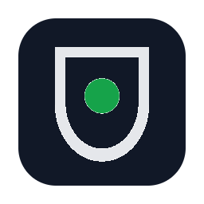
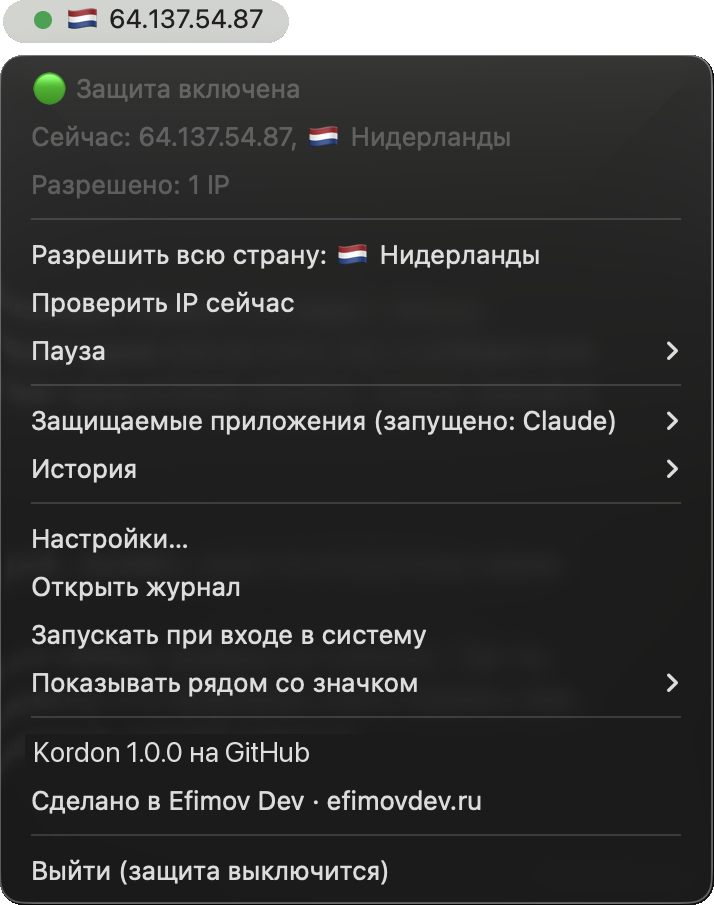
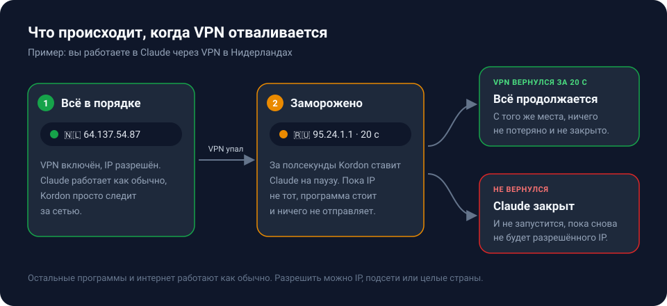

<p align="center">
  
</p>

<h1 align="center">Kordon</h1>

<p align="center">
  <b>Kill switch для приложений.</b> Отвалился VPN, сменился IP или пропал интернет - Kordon за долю секунды замораживает нужные программы. Вернулся правильный IP - они продолжают работу как ни в чём не бывало.
</p>

<p align="center">
  <a href="https://github.com/ef1m03/kordon/releases/latest"></a>
  <a href="https://github.com/ef1m03/kordon/actions/workflows/ci.yml"></a>
  
  <a href="LICENSE"></a>
</p>

<p align="center">
  <a href="#установка">Установка</a> ·
  <a href="#как-это-работает">Как работает</a> ·
  <a href="#настройки">Настройки</a> ·
  <a href="#что-kordon-отправляет-в-сеть">Приватность</a> ·
  <a href="README.en.md">English</a>
</p>

<p align="center">
  
</p>

## Зачем

Некоторые программы нельзя запускать «не с того» адреса: рабочий софт, который должен ходить только через корпоративный VPN, ИИ-ассистенты, мессенджеры, торрент-клиенты. VPN рвётся постоянно: после сна, при смене Wi-Fi, на переподключении. Программа в этот момент уже шлёт запросы с вашего настоящего IP, а вы узнаёте об этом последним.

Обычный kill switch внутри VPN-клиента рубит интернет целиком. Kordon работает точечно: трогает только те приложения, которые вы выбрали, а остальное оставляет как есть.

## Возможности

- **Заморозка вместо убийства.** Сменилась сеть - приложения ставятся на паузу за долю секунды. Если IP прежний, это незаметно. Если нужный IP вернулся в течение 20 секунд, приложение продолжает с того же места, ничего не теряется.
- **Закрытие, если IP так и не вернулся.** Сначала вежливо (приложение успевает сохраниться), через 5 секунд принудительно. Пока IP не разрешён, приложение не даст запустить заново.
- **Разрешённые IP, подсети и страны.** VPN часто меняет адрес внутри страны - разрешите всю страну, и не придётся подтверждать каждый новый адрес.
- **IP и страна всегда на виду.** На Mac - флаг и IP прямо в строке меню, на Windows - значок с кодом страны у часов. Цвет показывает состояние: зелёный, оранжевый, красный.
- **Готовые наборы:** Claude, ChatGPT, Codex, Cursor, Windsurf, GitHub Copilot, Gemini CLI, Perplexity, Telegram, Discord, Slack, Zoom. Плюс любое своё приложение.
- **Видит VPN в режиме прокси.** v2rayN, Hiddify, Clash и похожие клиенты работают как системный прокси, и Kordon проверяет IP через него - то есть видит тот же адрес, что и ваши программы.
- **Пауза** на 15 минут, час или до перезапуска.
- **История событий** прямо в меню и журнал в файле.
- **Режим для созвонов:** рядом со значком можно показывать только страну или ничего, чтобы IP не светился при показе экрана.
- **Без прав администратора**, без телеметрии, код открыт.

## Как это работает

<p align="center"></p>

Каждые полсекунды Kordon смотрит на сетевые адаптеры. Появился или исчез VPN-туннель, сменился Wi-Fi или локальный адрес - выбранные приложения сразу замораживаются, и тут же проверяется внешний IP. Если всё в порядке, они размораживаются, обычно меньше чем через секунду. Внешний IP сверяется и сам по себе, раз в 10 секунд: так Kordon замечает, когда VPN переключился на другой сервер, не меняя адаптеров.

Заморозка - это штатная пауза процесса в системе (`SIGSTOP` на Mac и Linux, `NtSuspendProcess` на Windows). Замороженная программа не выполняет ни одной инструкции и ничего не отправляет. Окно на это время перестаёт отвечать, это нормально.

## Установка

### macOS

Откройте Терминал и вставьте:

```bash
curl -fsSL https://raw.githubusercontent.com/ef1m03/kordon/main/scripts/install.sh | sh
```

Скрипт скачает свежую версию в «Программы», запустит её и включит автозапуск. Справа вверху, рядом с часами, появится зелёная точка с флагом и IP.

<details>
<summary>Установить вручную, без Терминала</summary>

1. Скачайте `Kordon-macos.zip` со страницы [последнего релиза](https://github.com/ef1m03/kordon/releases/latest) и распакуйте.
2. Перетащите `Kordon.app` в «Программы».
3. Первый запуск: **правый клик по Kordon → Открыть → Открыть.** Приложение не заверено в Apple (это платно, 99 $ в год), поэтому macOS спросит один раз.
4. На macOS 15 и новее вместо кнопки «Открыть» будет только «Готово». Тогда: Системные настройки → Конфиденциальность и безопасность → внизу «Kordon заблокирован» → **Всё равно открыть**.

Через `curl` такого не бывает: файл, скачанный из Терминала, macOS не помечает как «из интернета».
</details>

Поддерживаются macOS 11 и новее, Apple Silicon и Intel.

### Windows

Откройте PowerShell (Пуск → наберите «PowerShell») и вставьте:

```powershell
irm https://raw.githubusercontent.com/ef1m03/kordon/main/scripts/install.ps1 | iex
```

Kordon установится в вашу папку пользователя (права администратора не нужны), появится в меню Пуск и запустится. Значок с кодом страны появится у часов.

<p align="center"></p>

> Если значка не видно, он спрятался под стрелкой **^** у часов. Перетащите его оттуда на панель задач, чтобы страна была видна всегда.

<details>
<summary>Установить вручную</summary>

1. Скачайте `kordon-windows-amd64.exe` со страницы [последнего релиза](https://github.com/ef1m03/kordon/releases/latest) (для Windows на ARM - `arm64`).
2. Положите его куда удобно, например в `C:\Users\<вы>\Programs\Kordon\`, и запустите.
3. Если появится синее окно «Windows защитила ваш компьютер»: **Подробнее → Выполнить в любом случае.** Файл не подписан сертификатом (он платный), Windows предупреждает о любых таких программах.
</details>

Поддерживаются Windows 10 и 11, x64 и ARM.

### Linux

```bash
curl -fsSL https://raw.githubusercontent.com/ef1m03/kordon/main/scripts/install.sh | sh
```

Значок работает в KDE, XFCE, Cinnamon и других средах с системным треем. В GNOME нужно расширение [AppIndicator](https://extensions.gnome.org/extension/615/appindicator-support/). Без трея можно запустить `kordon headless` - тогда события пишутся в консоль и приходят уведомлениями.

## Первый запуск

1. При первом запуске Kordon **запоминает текущий IP как разрешённый**. Поэтому ставьте его, когда VPN уже включён.
2. По умолчанию защищается **Claude**. Другие приложения включаются в меню **«Защищаемые приложения»**.
3. Если VPN выдаёт разные адреса в одной стране, нажмите в меню **«Разрешить всю страну»**.
4. Автозапуск включается сам. Выключить можно в меню галочкой **«Запускать при входе в систему»**.

## Меню

| Пункт | Что делает |
|---|---|
| 🟢 Защита включена | Состояние. 🟠 - приложения заморожены и идёт обратный отсчёт, 🔴 - закрыты, ⚪ - пауза |
| Сейчас: 64.137.54.87, 🇳🇱 Нидерланды | Текущий внешний IP и страна |
| Разрешено: 2 IP, страны NL | Что сейчас разрешено |
| Разрешить этот IP / всю страну | Появляется, когда текущий адрес не в списке. Одно нажатие - и приложения размораживаются |
| Проверить IP сейчас | Не ждать следующей проверки |
| Пауза | На 15 минут, час или до перезапуска. Всё замороженное сразу размораживается |
| Защищаемые приложения | Галочки для готовых наборов. В заголовке видно, что из них сейчас запущено |
| История | Последние события: смены сети и IP, заморозки, закрытия |
| Настройки… | Открывает `config.yaml` |
| Показывать рядом со значком | Страну и IP, только страну или ничего |

## Настройки

Всё хранится в одном файле с комментариями. Сохраните его - Kordon подхватит изменения сам, перезапуск не нужен. Если в файле ошибка, придёт уведомление, а Kordon продолжит работать со старыми настройками.

| Система | Где файл |
|---|---|
| macOS | `~/Library/Application Support/Kordon/config.yaml` |
| Windows | `%APPDATA%\Kordon\config.yaml` |
| Linux | `~/.config/kordon/config.yaml` |

```yaml
apps:
  - "claude"
  - "cursor"

custom_apps:
  - name: "Мой клиент"
    match: ["/MyClient.app/", "myclient.exe"]

allow:
  ips:
    - "64.137.54.87"
    - "185.12.40.0/24"
  countries:
    - "NL"
    - "DE"

freeze_on_network_change: true   # замораживать при любой смене сети, пока не проверим IP
block_when_offline: true         # пропал интернет - тоже замораживать
grace: 20s                       # сколько ждать разрешённый IP в заморозке
close_timeout: 5s                # сколько ждать вежливого закрытия
check_interval: 10s              # как часто сверять IP, когда всё хорошо
menubar: ip                      # ip, country или icon
```

### Своё приложение

В `match` можно писать:

- **имя файла** программы: `myapp` или `myapp.exe`;
- **часть пути** (со слешем): `/MyApp.app/` на Mac, `\MyApp\` на Windows;
- **часть командной строки** для скриптов на Node или Python: `args:my-tool/cli.js`.

Имя файла смотрите в «Мониторинге системы» на Mac или в «Диспетчере задач» на Windows (вкладка «Подробности»).

## Команды в терминале

```text
kordon status          IP, страна и состояние
kordon allow           разрешить текущий IP
kordon allow 1.2.3.4   разрешить IP или подсеть (1.2.3.0/24)
kordon allow NL        разрешить страну
kordon config          путь к файлу настроек
kordon autostart on    включить или выключить автозапуск
kordon headless        работать без значка
kordon version
```

На Mac команда лежит внутри приложения: `/Applications/Kordon.app/Contents/MacOS/kordon`. На Windows - `%LOCALAPPDATA%\Programs\Kordon\kordon.exe`.

## Что Kordon отправляет в сеть

Код открыт целиком, проверить можно каждую строчку. Kordon делает только два вида запросов:

1. **Узнать внешний IP:** `api.ipify.org`, `ipv4.icanhazip.com`, `v4.ident.me`. Спрашиваются все три сразу, берётся первый ответ. Список меняется в `ip_services` - можно поставить свой сервер, который просто отдаёт IP текстом.
2. **Узнать страну по IP:** `ipinfo.io`, запасные - `ipapi.co` и `api.country.is`. Ответ запоминается, один и тот же адрес второй раз не спрашивается.

Больше ничего: ни аналитики, ни счётчиков, ни проверки обновлений. Настройки и журнал лежат только у вас на компьютере.

## Ограничения

Пишем честно, чтобы не было сюрпризов:

- Смену сети Kordon замечает **в течение 0,5 секунды**, а не мгновенно. Если VPN поменял сервер без смены адаптеров, это видно только при сверке IP, раз в 10 секунд. Если нужна гарантия на уровне сети, используйте kill switch вашего VPN вместе с Kordon.
- **PAC-скрипты прокси** (автонастройка по адресу) не поддерживаются, только обычный системный прокси.
- На Windows **Claude Code, установленный через npm**, работает как `node.exe` и по имени не отличается от других Node-программ. Ставьте Claude Code нативным установщиком: тогда это `claude.exe`, и Kordon его видит.
- Kordon защищает программы **вашего пользователя**. Службы и программы, запущенные от администратора, он не трогает.
- Если Kordon закрыть принудительно (через «Диспетчер задач», `kill -9`), замороженные приложения останутся на паузе до следующего запуска Kordon. Он разморозит их сразу при старте. Обычный «Выйти» в меню размораживает всё.

## Удаление

macOS и Linux:

```bash
curl -fsSL https://raw.githubusercontent.com/ef1m03/kordon/main/scripts/install.sh | sh -s uninstall
```

Windows (PowerShell):

```powershell
& ([scriptblock]::Create((irm https://raw.githubusercontent.com/ef1m03/kordon/main/scripts/install.ps1))) -Uninstall
```

Файл настроек остаётся на месте на случай, если вы вернётесь.

## Сборка из исходников

Нужен [Go](https://go.dev/dl/) той версии, что указана в `go.mod`.

```bash
git clone https://github.com/ef1m03/kordon && cd kordon
go test ./...
./scripts/build-mac.sh       # dist/Kordon.app (на Mac, нужен Xcode Command Line Tools)
./scripts/build-windows.sh   # dist/kordon-windows-*.exe (собирается с любой системы)
CGO_ENABLED=0 go build ./cmd/kordon   # Linux
```

Тесты проверяют логику на «быстрой перемотке» времени, а на каждой из трёх систем ещё и настоящую заморозку, разморозку и закрытие живого процесса. Всё это гоняется в GitHub Actions на macOS, Windows и Ubuntu при каждом изменении.

Для разработки удобно запускать Kordon с отдельной папкой настроек, чтобы не трогать рабочую: `KORDON_DIR=/tmp/kordon-dev go run ./cmd/kordon`.

## Вопросы

**Это VPN?** Нет. Kordon не шифрует трафик и не меняет IP. Он следит, чтобы выбранные программы работали только тогда, когда IP правильный.

**Почему заморозка, а не сразу закрыть?** VPN чаще всего переподключается за пару секунд. Закрывать программу на каждом таком моргании - значит терять несохранённое и открывать её заново по десять раз в день.

**Окно приложения «зависло».** Значит, оно заморожено: в строке меню оранжевая точка и обратный отсчёт. Включите VPN, разрешите текущий IP или поставьте паузу.

**Можно защитить браузер?** Можно, добавьте его в `custom_apps`. Но браузер замёрзнет целиком, со всеми вкладками.

---

<p align="center">
  Автор - <a href="https://github.com/ef1m03">ef1m03</a>. Сделано в <a href="https://efimovdev.ru"><b>Efimov Dev</b></a> - разрабатываем сайты, сервисы и приложения.<br>
  Нашли ошибку или есть идея - <a href="https://github.com/ef1m03/kordon/issues">пишите в Issues</a>. Лицензия <a href="LICENSE">MIT</a>.
</p>
